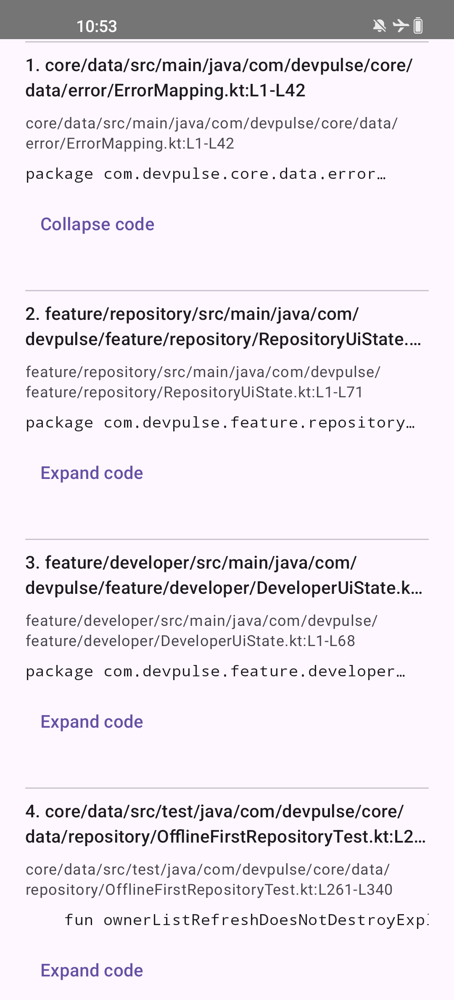
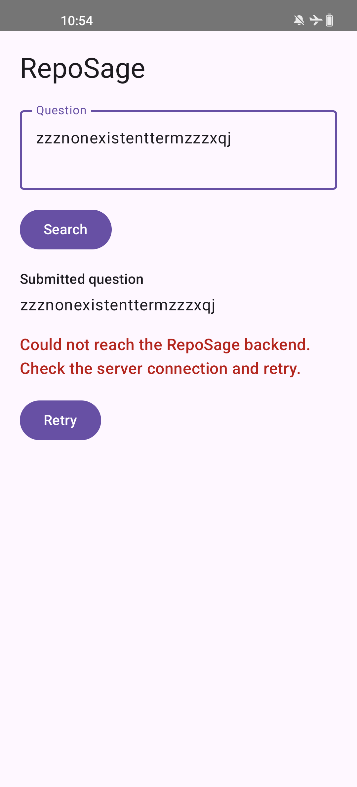

# RepoSage

RepoSage is a local repository retrieval prototype. It indexes a local Git
checkout into SQLite, exposes search through a small Python API, and provides a
debug Android client that renders exact source snippets with repository-relative
line citations.

The current Android milestone is retrieval only. The backend also has an
experimental `/answer` endpoint that asks Gemini for structured answers grounded
in retrieved chunks and validates the returned source IDs before resolving
citations. Embeddings, authentication, cloud sync, saved Android history, and
multi-repository management are not implemented.

## Current Functionality

- Python CLI indexes tracked source/documentation files from a local checkout.
- SQLite FTS5 stores chunked source text and index metadata.
- FastAPI exposes `GET /health` and `POST /search` against a prebuilt local
  index.
- FastAPI exposes optional `POST /answer` when `GEMINI_API_KEY` is configured on
  the server.
- Android debug app submits a question to the API and shows loading, result,
  empty, and retryable error states.
- Results include exact code snippets and citations such as
  `core/data/src/main/java/.../ErrorMapping.kt:L1-L42`.
- Snippets can be expanded inline in the Android client.

## Architecture

```text
Android Compose app
  -> Retrofit/OkHttp client
  -> Python FastAPI /search endpoint
  -> RepoSage retrieval core
  -> SQLite FTS5 index built from a local Git checkout

Optional backend-only answer flow:

Python FastAPI /answer endpoint
  -> RepoSage retrieval core
  -> bounded source-ID evidence context
  -> Gemini structured output
  -> server-side source-reference validation
```

The Android app does not index repositories itself. It expects the Python
backend to be running against an existing SQLite index. The backend does not
clone repositories or execute indexed code.

Setup details live in:

- [Backend setup and API docs](backend/README.md)
- [Android setup, build, and install docs](android/README.md)
- [Task 003 verification report](outputs/task-003-report.md)
- [Task 004 answer-generation report](outputs/task-004-report.md)

## Verified Checkpoint

Verification was performed on October 12, 2026 for the Android retrieval slice.

- Backend unit/API tests: 8 passed.
- Fixed DevPulse evaluation fixture: 4/5 top-five hits.
- Android JVM unit tests: 6 passed.
- Android debug build: passed with JDK 17.
- Physical device validation: passed on a connected OnePlus device for real
  search, exact citations/code, expanded snippets, empty results,
  backend-down error, successful retry, and rotation preserving an unsent draft
  without duplicate backend requests.
- APK from the device build:
  `android/app/build/outputs/apk/debug/app-debug.apk`
- APK SHA-256 recorded during validation:
  `560e992f9572289f272461af8ab7e6b5bd5b8920aceff17407aa729633c04aa8`

The APK itself, generated SQLite database, virtual environments, local SDK/JDK
configuration, caches, and copied source corpora are intentionally not committed.

## Screenshots

These screenshots were captured from the connected Android device using
non-personal test content.





## Known Limitations

- Retrieval quality is still basic lexical ranking. The fixed five-question
  DevPulse fixture currently scores 4/5 top-five hits; the
  `devpulse-toggle-saved` case remains a known miss for the manually expected
  ViewModel/catalog chunks.
- The Android client is a debug vertical slice and requires a separately running
  local backend.
- Generated answers are backend-only in Task 004; the Android app still shows
  retrieved source evidence only.
- Source-reference validation verifies that generated claims cite supplied source
  IDs and that citations are resolved from stored metadata. It does not prove
  semantic correctness.
- No production hardening, authentication, remote repository management, or
  concurrent reindex coordination has been added.

## Quick Start

Backend:

```bash
python -m venv .venv
source .venv/bin/activate
python -m pip install -e "backend[test]"
reposage index --repo /path/to/local/repo --db .data/devpulse.db
REPOSAGE_DB_PATH=.data/devpulse.db uvicorn reposage.api:app --host 127.0.0.1 --port 8000
```

Android emulator:

```bash
cd android
./gradlew testDebugUnitTest assembleDebug
adb install -r app/build/outputs/apk/debug/app-debug.apk
```

Physical USB device:

```bash
adb reverse tcp:8000 tcp:8000
cd android
./gradlew assembleDebug -Preposage.backendUrl=http://127.0.0.1:8000/
adb install -r app/build/outputs/apk/debug/app-debug.apk
```
